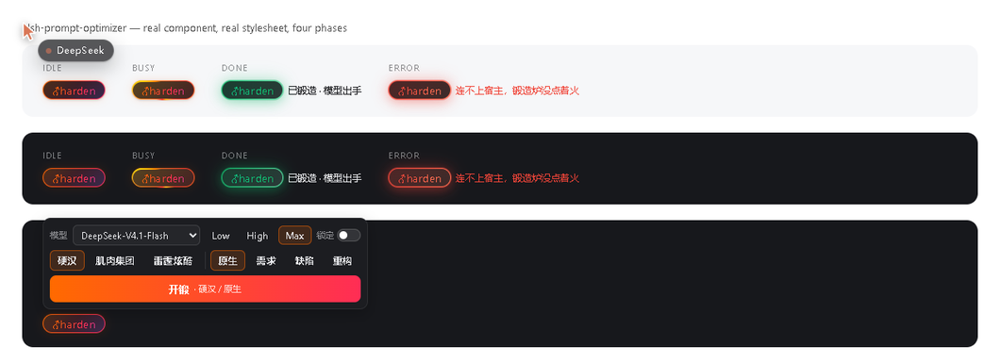

# ♂harden

> 草稿扔进去，出来的是作战指令。**你的要求一条不丢，废话一句不留。**
>
> A hard-boiled prompt rewriter for the DeepSeek Harness composer.

[](https://github.com/xxxxxgold/dsh-prompt-optimizer/actions/workflows/selftest.yml)




---

## 30 秒看懂

DSH 对话输入框左下角多出一个 **`♂harden`** 按钮。点它弹出一块扁平紧凑的面板：一行**模型 + 思考强度 + 锁定开关**——模型默认当前 DSH 模型，挡位从当前模型自己的配置里读，默认取该模型上一次的设定，没有记录才用模型默认，没有思考挡位的模型不显示挡位；锁定开关直接冻结模型与强度。第二行是**口味**（`native` / `hard` / `team` / `cool`）和**产出规范**（原生 / 需求 / 缺陷 / 重构），随便点、**面板不会关**。选好了再按底下的「**开锻**」：

```
你的草稿  →  模型重写  →  硬汉任务书  →  直接写回输入框
```

**不改你的意思，只换你的口气。** 先看再发，不自动发送。

规矩钉死，一个字都不许变：

- 按钮文字恒为 **`♂harden`** —— `♂`(U+2642) + `harden`，共七个字符。四个状态（空闲/锻造中/成功/失败）**全用这一个字**：不换字、不加符号、不改大小写、不翻译。
- 事实全保真：交付物、技术栈、版本、尺寸、数量、时间、格式、"不许碰什么"，一条不落。
- 不编新事实：不新增原文没有的步骤、指标、库名、人名。
- 原文什么语言，输出什么语言。
- 模型挂了也有本地兜底 —— 按钮永远有产出，绝不给你一个干瞪眼的错误框。
- **零第三方运行时依赖**：宿主半只用 DSH 公开契约，客户端半只吃 `react`。
- 选了 Trellis 规范却够不着模型时**不糊弄**：直接报错说清是哪一环没通，绝不给你一份假任务书。

---

## 硬汉长什么样（真实对照）

本机 `commandcode / deepseek/deepseek-v4.1-flash-fast`，3.4 秒：

> **进**：写一个 Python 脚本，把目录里的图片压缩到 500KB 以内；要求不改文件名，支持 jpg/png
>
> **出**：
> 哥们，直接给我整个 Python 脚本出来，别整虚的！
> 硬指标就这几条，一条都不许漏：
> - 用 Python 写，一个脚本，写完就能跑。
> - 把当前目录里的 jpg 和 png 图片全给我压了。
> - 压完每张图都得在 500KB 以内，超一点都不行。
> - 文件名不许改，原来叫啥现在还叫啥，一个字都不能动。
>
> 别墨迹，别搞半成品，别留 TODO……交活儿之前自己先逐条核一遍……冲冲冲！
> 哥们，这活儿性命攸关，写漂亮点，一次性交付，给我硬邦邦的，耍起耍起！

**提炼出来的风格骨架**：动员开场 → 硬指标清单 → 自我验收 → 催命收尾。
人称「哥们/老哥」，短句命令式（「直接给我整一个」「别整虚的」「怎么狠怎么来」），强度词管够（硬邦邦、雷霆炫酷、细节拉满、性能榨干、肌肉集团、冲冲冲、耍起耍起），反墨迹（禁止磨叽、禁止无谓独立审查、禁止半成品/占位符/TODO、一次性交付），能并行就并行。

---

## 按钮状态

| 状态 | 长什么样 | 说明 |
|---|---|---|
| 输入框为空 | 胶囊降透明度 | 仍可点开菜单；点了会提示「输入框是空的，先写点东西哥们」，不发给宿主 |
| 空闲 | 四色渐变环（橙→玫红→紫→金），8 秒极慢流动 + 渐变文字 + 静态辉光 | 可点 |
| 锻造中 | **跑马灯双环**：外环 conic 光环 2px 旋转（1.05s 一圈）+ 内侧静态琥珀细环 + 呼吸辉光 + 高光扫过 | 禁用防连点；文字仍是 `♂harden` |
| 成功 | **青绿双环**（静态环 + 顶部径向高光）+ 一次弹跳 + 柔和呼吸 | 结果已写回输入框，右侧小字「已锻造 · 模型出手」 |
| 失败 | **红橙警示斜纹环**（45° 条纹）+ 一次抖动，无光晕 | 右侧红底提示卡写原因，留 15 秒，点一下可复制 |

> 四态边框视觉语言互不相同：空闲是"安静流动"，锻造中是"双环旋转 + 光晕"，成功是"双环 + 顶部高光"，失败是"斜纹 + 抖动"。关掉动画也能一眼分清。

---

## 安装

### 前置

| 要什么 | 怎么确认 |
|---|---|
| DSH 跑得起来（桌面版或 CLI 版） | 能打开对话界面 |
| Node ≥ 18 | `node -v` |
| Git（走 GitHub 直装才要） | `git --version` |

### 路子一：从 GitHub 直装（最快）

**桌面版（Electron）** —— 桌面版的 profile 由应用独占管理，`dsh` CLI 碰不得，所以走界面：

1. 打开 DSH → **设置 → 插件**
2. 在安装框里粘这一行，确认：

   ```
   github:xxxxxgold/dsh-prompt-optimizer
   ```

3. 装完**刷新页面**（`Ctrl+R`），输入框左下角就该有 `♂harden`。

**CLI 版（非 Electron 托管的 profile）**：

```powershell
dsh plugin --profile <你的-profile> add github:xxxxxgold/dsh-prompt-optimizer
```

### 路子二：本机目录（开发用，改代码即时生效）

```powershell
# 1. 拉到本地
git clone https://github.com/xxxxxgold/dsh-prompt-optimizer.git D:\dsh-plugins\dsh-prompt-optimizer

# 2A. CLI 版：link 进去
dsh plugin --profile <你的-profile> add link:D:\dsh-plugins\dsh-prompt-optimizer

# 2B. 桌面版：设置 → 插件 → 安装框里粘
#     link:D:\dsh-plugins\dsh-prompt-optimizer
```

`link:` 装的是**活目录**：改 `client.js` / `index.js` 立即生效，不用重装。

### 路子三：手动挂（硬核，不问任何工具）

不用 CLI、不用界面，直接改 profile 文件：

1. clone 到任意目录，比如 `D:\dsh-plugins\dsh-prompt-optimizer`
2. 找到 profile 目录：
   - Windows：`C:\Users\<你>\.dsh\profiles\<profile>\`
   - 桌面版 profile 名一般就叫 `desktop`
3. 编辑该目录下的 `package.json`：

   ```json
   {
     "dependencies": {
       "dsh-prompt-optimizer": "link:D:/dsh-plugins/dsh-prompt-optimizer"
     },
     "dsh": {
       "profile": {
         "bundles": [
           "@deepseek-ai/dsh-base",
           "@deepseek-ai/dsh-web-app",
           "dsh-prompt-optimizer"
         ]
       }
     }
   }
   ```

   **两处都要加**：`dependencies` 让它装得上，`bundles` 让它挂得进。

4. 在 profile 目录里装依赖：

   ```powershell
   cd $env:USERPROFILE\.dsh\profiles\<profile>
   pnpm install
   ```

5. **重启 DSH**（手动挂不吃热重载）。

### 装完自己验一遍（三步，硬证据）

```powershell
# 1. 宿主半活着吗？（端口换成你 DSH 的实际端口）
curl.exe http://127.0.0.1:19387/dsh-prompt-optimizer/health
# → {"ok":true,"plugin":"dsh-prompt-optimizer","version":"0.6.1","style":"hard","styles":["native","hard","team","cool"],"preset":"native","presets":["native","feat","issue","refactor"],"localFallback":true,"maxTokens":"model","reasoningEffort":"selection","motion":"always"}

# 2. 插件在不在清单里
dsh plugin --profile <你的-profile> list

# 3. 眼见为实
#    刷新页面 → 输入框左下角有 ♂harden → 写几个字 → 点它 → 3~6 秒后草稿被改写
```

### 卸载

```powershell
dsh plugin --profile <你的-profile> remove dsh-prompt-optimizer
```

桌面版：**设置 → 插件 → 找到 `dsh-prompt-optimizer` → 移除**，然后刷新页面。
手动挂的：把 `package.json` 里那两处删掉，`pnpm install`，重启。

### 装不上，查这里

| 症状 | 病根 | 干法 |
|---|---|---|
| `profile "desktop" is managed exclusively by the Electron application` | 桌面版 profile 只认应用内管理器 | 别用 CLI，走 **设置 → 插件** |
| 装完没按钮 | 客户端半没重新加载 | **刷新页面**（`Ctrl+R`）；不行就重启 DSH |
| 按钮发灰、像点不动 | 输入框是空的（口味仍能选，只差内容） | 先写字再点 |
| `{"ok":false,"error":{"code":"NO_ADAPTER"}}` | 没有可用模型路由 | 在配置里显式写 `provider` / `model`，或留着 `localFallback: true` 让本地兜底顶上 |
| `{"code":"unknown-plugin"}` | 插件名/profile 写错 | 名字就是 `dsh-prompt-optimizer`，一字不差 |
| 装完还是老样子 | 改的是宿主半… | 宿主半改动要在插件管理器里**关掉再打开**；客户端半改动刷新页面 |
| `dsh` 里找不到插件 | profile 名不对 | `dsh plugin --profile <名> list` 逐个试 |

---

## 怎么用

1. 在对话输入框写你的草稿（多糙都行）。
2. 点 **`♂harden`** —— 弹出四个口味，点哪个就用哪个锻。
3. 等 3~6 秒（按钮进「锻造中」）。
4. 结果已在输入框里 —— **看完再发**。不满意就 `Ctrl+Z`，编辑器自带撤销。

口味就在按钮上选，不用改配置：菜单里高亮的是上次用过的那个（记在 `localStorage`），按 `Esc` 或点菜单外面都能收起。想固定默认值，才需要动配置或 HTTP 调用里的 `"style"`。

| 口味 | 侧重 |
|---|---|
| `native`（菜单里叫「原生」） | 不换口气：保留原文要求，只整理成清晰条目。与规范里的「原生」互斥——选一个，另一个自动让位并置灰 |
| `hard`（菜单里叫「硬汉」） | 纯硬汉直给（默认） |
| `team`（菜单里叫「肌肉集团」） | 肌肉集团总动员：拆成可并行的几块、成员自己起炫酷名字、分开干再拼装。原文没提团队时只说「能并行就并行」，不编成员名 |
| `cool`（菜单里叫「雷霆炫酷」） | 雷霆炫酷：视觉/体验类要求强调拉爆、榨干、严丝合缝，但不新增具体参数 |

口味四个横向一行摆开、不换行；窗口窄的时候整行横向滑动。选 chip 只改高亮，不触发请求，也不会把面板关掉 —— 两个维度可以慢慢挑完再开锻。中文界面显示中文名，英文界面显示 native / hard / team / cool，配置里的 `"style"` 值始终是这几个英文 id。

### 产出规范：一按就成 Trellis 任务书

下排四个「规范」是另一条正交的轴 —— 口味管**口气**，规范管**骨架**。选「原生」就是原来的一整段硬汉提示词（与口味的「原生」互斥，二者不会同时亮）；选另外三个，输出直接换成对应工作类型（[Trellis](https://github.com/1264459619/dsh-trellis)）的任务卡形状，粘进 `trellis_task_create` 就能开单：

| 规范 | 产出骨架 | 对应 Trellis 轨道 |
|---|---|---|
| `native`（原生，默认） | 一整段硬汉提示词，不分节 | —— |
| `feat`（需求） | 任务标题 + 背景问题 + 目标/非目标 + 范围 + 验收标准 + 约束风险 + 执行步骤（每条带「验收」「验证」）+ 阶段纪律 | `prd → design → impl → review → check` |
| `issue`（缺陷） | 现象 + 复现步骤 + 期望vs实际 + 影响范围 + 证据 + 根因候选（≤3）+ 修复方案 + 回归验证 | `report → analyze → fix → fix-note` |
| `refactor`（重构） | 现状扫描 + 候选范围 + 目标结构 + 行为不变契约 + 分批迁移步骤 + 阶段纪律 | `scan → design → apply → done` |

硬约束：**事实仍然一条不丢**，模型只负责换骨架和口气，不许往里塞原文没有的步骤或指标。本地兜底只会写「原生」那种整段提示词 —— 所以选三个规范之一时如果没有可用模型，界面会明说 `PRESET_NEEDS_MODEL`，不会拿假骨架骗你。

---

## 文档

README 只讲怎么装、怎么用。其余内容在 [`docs/`](./docs/index.md)：

| 文档 | 内容 |
|---|---|
| [配置](./docs/configuration.md) | 全部 `config` 字段、默认值、行为含义 |
| [HTTP 面](./docs/http-api.md) | 5 个端点、错误码、预算从哪来、三条降级路径 |
| [开发](./docs/development.md) | `npm run check`、CI 矩阵、296 项自测覆盖、重出截图 |
| [已知边界](./docs/known-limits.md) | 刻意取舍与模型天性 |

工程规范（编码约定、禁止模式、断言有效性要求）在 `.trellis/spec/frontend/`，只对在本仓库改代码的人有意义，不随 npm 包发布。

---

## 为什么这么干（三句话）

- **走同源 HTTP 面，不走 `host.call`**：`host.call` / `harness.handle` 只属于 `cordis-client-runner` 动态加载的 Cordis 包；bundle 包的客户端半是普通 `__ModuleLoader__` 模块，拿不到那条通道。
- **宿主半零 `@deepseek-ai/*` 依赖**：profile 安装的插件按 profile 解析裸模块名，为了不把加载绑死在模块解析上，只用公开契约（`ctx.llm.stream()` chunk 协议、`GenerateOptions.messages`、`ctx.agentDefaultModel.currentSelection()`、`ctx.webServer.register({ kind: 'prefix' })`）。
- **读写都走编辑器自己的门**：`useInput(s => s.draft)` 读、`inputActions.setDraft(text)` 写。不碰 DOM、不碰 Lexical 实例。整条链路 try/catch 包住 —— 注册失败最多是没按钮，绝不弄坏对话。

---

## License

[MIT](LICENSE)
